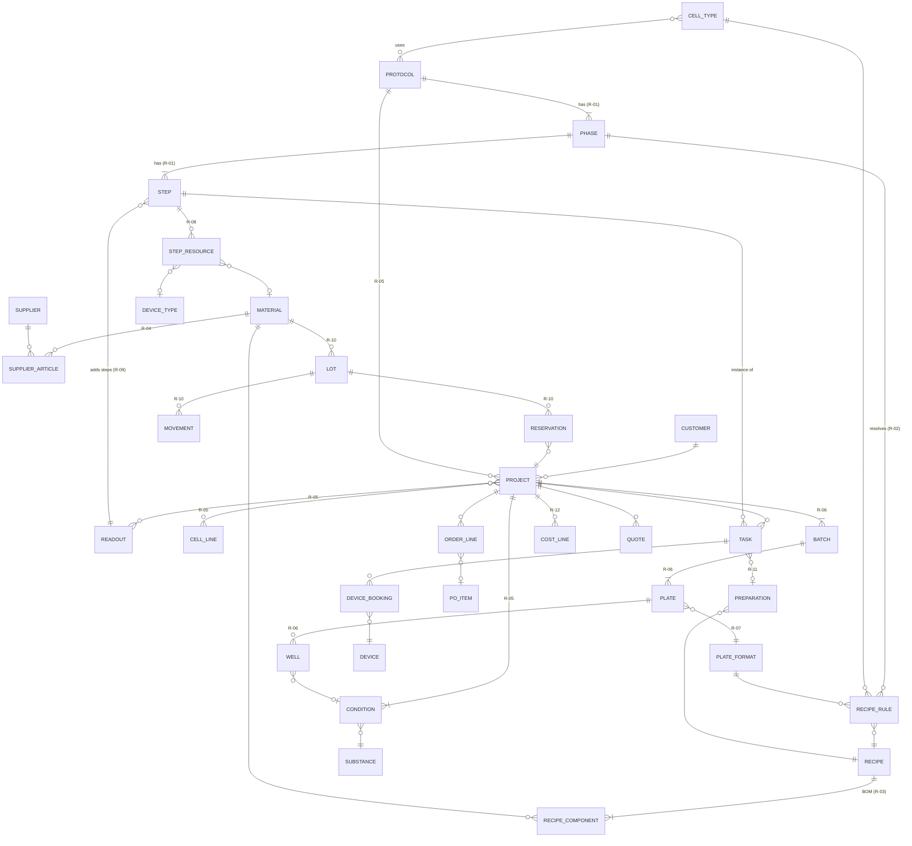

# R-00 ER overview

Mermaid diagram (paste into any Mermaid renderer). Cardinalities are PROPOSED; open ones are marked in the relation docs.

## Relation docs
- R-01 Protocol → phase → step
- R-02 Recipe resolution (phase × cell type × plate format → recipe)
- R-03 Recipe BOM (recipe → component → material)
- R-04 Material ↔ supplier (supplier article)
- R-05 Project → protocol, cell lines/types, readouts, conditions
- R-06 Project → batch → plate → well
- R-07 Plate → plate format (volume scaling)
- R-08 Step → resources (materials, devices, labour)
- R-09 Readout → added steps and resources
- R-10 Material → lot → movement / reservation
- R-11 Task → preparation → lots consumed
- R-12 Project → cost lines → sources
